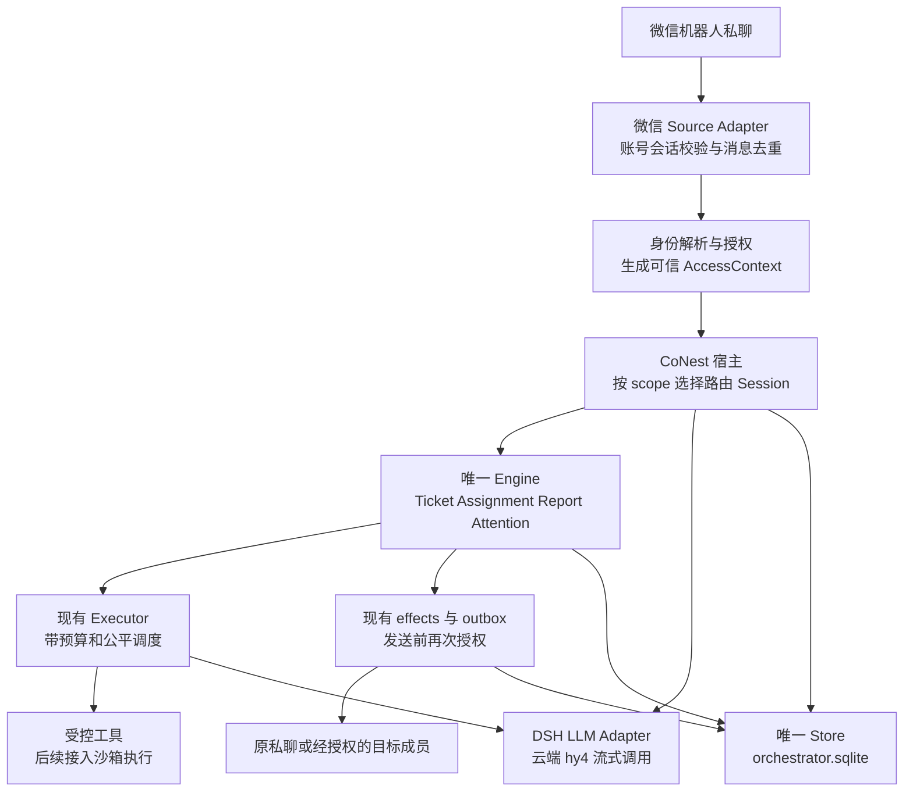

# CoNest 多用户开发方案

日期：2026-11-17。状态：设计提案。

实施进展：M0 的真实 DSH/hy4 工具往返和微信单账号收发已通过，用户确认手机收到回复。已新增主 Runtime 的单 owner 微信 Source，接入原有工单和 outbox，并完成 GitHub 可选启动；离线集成覆盖建单、追问、私聊续接和结果回传。真实主 Runtime 现场复测记录见[部署文档](weixin-runtime.md)。这还不是 M1 的成员隔离验收。用户暂无第二个微信账号，双账号现场验证暂缓；N100 已确认 Ubuntu WSL2，真机运行和容量仍待验证。

CoNest 在 Intel N100 上运行身份管理、任务编排、工具执行与持久化，模型推理使用云端 hy4。继续以 DSH SuperAgent 的 Engine 作为唯一的 Ticket、Assignment、Report 和 Attention 状态机，在宿主层补齐成员授权、按访问范围隔离的上下文、受控工具与可靠投递。

目标机当前运行 Windows，已安装 WSL；主运行环境选择 WSL2 内的 Linux。首个版本面向一个约 10 人的小家庭或小团队，优先微信机器人，最多约 100 个未完成任务，允许排队。先完成两名成员各自私聊、各自执行任务和接收结果的闭环，再扩至 10 人并增加显式共享与群协作。100 是未完成工单的容量目标，实际执行从 1 个 worker 起步；多人在线不需要为每人常驻一个 worker。

## 当前基础与开发缺口

| 范围 | 已有代码 | 需要完成的工作 |
| --- | --- | --- |
| 工单内核 | `src/core` 的 Engine、Ticket、Assignment、Report、Attention | 复用状态机，为订阅、附加输入和操作工单补齐宿主授权；通用任务沿现有 Report 路径完成 |
| 成员授权 | `src/family` 的类型和默认拒绝函数 | 持久化成员与绑定，在消息准入、读取、执行、投递时实际调用 |
| 消息接入 | GitHub、飞书与单 owner 微信 Source；`src/ingress/messages.ts` 已实现映射 | 扩展微信多账号与持久化成员绑定，补齐跨成员授权和范围隔离 |
| Session | `src/app/runtime.ts` 保存一个 `masterId`，每个工单有 worker Session | 将私有路由上下文按访问范围拆开，避免共享主 Session 累积所有人的内容 |
| 执行权限 | `src/app/sessions.ts` 使用 `danger-full-access`，目录和命令包装不隔离文件访问 | 首版只开放经过授权的结构化工具；任意命令与文件工具须经沙箱后开放 |
| 存储 | Store 独占打开 `orchestrator.sqlite`，已有 WAL、事务、effects 和 outbox | 在同一 Store 增加家庭授权记录、范围索引、预算记录和迁移 |
| 记忆 | `MemoryGrant` 只是授权骨架；`src/core/memory.ts` 是测试用内存仓储 | 增加真正的记忆条目与按条目授权，不能把测试仓储当作长期记忆 |
| 面板 | 回环地址上的运维面板，校验同源请求 | 保留管理员用途；成员网页入口必须有独立登录、授权和受限数据视图 |
| 启动 | `src/app/setup.ts` 在明确禁用 GitHub 时跳过账号解析，微信专用 Runtime 已启动验证 | 保持 GitHub 原有部署的兼容性，继续做 N100 部署验证 |

现有家庭授权测试只证明纯函数行为。实施前的历史基线为：开发机 Node.js `v26.3.0`、pnpm `11.7.0`，类型检查与单独构建通过，1211 项测试通过、12 项 ingress 契约失败。后续已用真实消息映射实现这些契约，并新增主 Runtime 工单集成测试；当前 `pnpm check` 为 1251 项通过，类型检查与构建通过。

## 首版范围

首版提供成员绑定与停用、微信私聊会话、私有工单、任务进度、停止和重试、定向追问、显式记忆与重启恢复。微信为第一入口，网页先提供操作者使用的绑定与运维能力；成员网页和飞书扩展后续安排。

首批工具选择可在宿主严格限定资源的能力，例如管理自己的记忆、读取明确授权的资料、生成工单附件和提交任务报告。首版对工具写操作分别定义 `write` / `share` / `stop` / `retry` 权限，不能用 `read_task` 推导所有权限。

群协作、任意 shell、浏览器自动化、跨家庭托管与长期自主目标分阶段上线。微信先验证账号绑定与私聊收发，群能力另行验证；飞书能力不能直接作为微信能力。

## 微信机器人接入

优先参考 [腾讯官方 openclaw-weixin](https://github.com/Tencent/openclaw-weixin/blob/main/README.md) 的微信接入实现。该项目提供扫码绑定、多账号和长轮询，但它是 OpenClaw 插件，安装依赖 OpenClaw。CoNest 将实现自己的 DSH Source，使用经核实的传输行为，保留 SuperAgent 作为唯一任务状态机。

首轮验证区分两个产品入口：一个机器人接收多位成员的私聊，以及各成员授权自己的机器人后连接到同一 CoNest。官方多账号能力适合验证后一条路径，不能据此假定前一条路径已经可用。先用两个真实成员完成“绑定、稳定身份识别、收发隔离、重启后收发”，再确定十人的具体入驻方式。每账号独立维护连接与凭证，执行共用任务槽位，无须每账号运行一套 Agent。

微信 Source 首版只做文本私聊。协议参考中的 [getUpdates 与 sendMessage](https://github.com/Tencent/openclaw-weixin/blob/main/docs/protocol.md) 描述长轮询游标、回复上下文 token 和客户端消息 id，也明确客户端类型不等于完整服务端契约。将账号、peer、游标及回复凭据关联保存；HTTP 200 后仍检查业务返回。`context_token` 不作为用户授权，不能串账号或跨会话使用；缺失或被服务端拒绝时标为待恢复，不无限重试，不假定固定有效期。

入站消息与游标推进在同一事务中落库，避免推进游标后丢消息；每个账号仅一个有效轮询者。长轮询、云模型请求与工具执行分别计数，微信连接数不占 worker 槽位。多段回复采用稳定的业务消息与分段 id；保留发送失败与不确定回执，不能把客户端 id 当作已经验证的服务端去重保证。

绑定界面需预留二维码、PIN 与重新授权状态。腾讯 [3.0.0-beta-0 说明](https://github.com/Tencent/openclaw-weixin/blob/main/docs/release-notes-bot-realname-auth_zh_CN.md) 已描述 PIN 和本人或他人绑定流程，属于预发布参考；实施时锁定实际采用的版本与提交，按服务端响应走流程。复用代码时保留其 [MIT 版权声明](https://github.com/Tencent/openclaw-weixin/blob/main/LICENSE)。

当前 SourceRegistry 每种 kind 只解析一个实例，不能直接配置十个同名 Source。多用户首版拟在 `weixin` Source 内管理账号列表，配置仅保存账号引用，凭证由宿主在仓库外保管。内部账号 id 进入身份绑定、会话范围、幂等键、线程、缓存及出站地址。目前已替换抛错桩并注册真实单 owner Source；账号列表与成员级上下文仍按后续阶段实施。

协议中出现 `group_id` 不证明群功能可用。群入口须在传输验证和群成员授权模型都完成后开放；首版先通过各成员私聊共享已授权的工单协作。

## 运行结构

### 身份与授权模块

在 `src/family` 扩展领域类型，宿主将外部事件解析为可信的 `AccessContext`。其中包含家庭或小组标识、成员、会话范围和权限版本；由经过账号会话校验的 Source 或有效网页登录生成，模型参数里的 `memberId` 不作为身份凭据。

身份绑定采用 `(sourceKind, sourceInstanceId, externalUserId)` 唯一键。当前 `IdentityBinding` 只有 `source + externalId`，接入多机器人时必须补上实例维度；微信以实际绑定的 bot 账号与 peer 稳定标识解析成员。绑定通过管理员操作或一次性绑定码建立，不能按昵称自动认人。家庭或小组 id 首版固定一个值，先为记录提供所属范围，不把预留字段当成已经支持多租户。

授权在四类位置执行：消息进入 Engine 前、读取工单和资料前、工具执行前、消息发出前。附加到旧工单、订阅扇出、手动重试、停止以及直接访问 worker Session 都要经过相同检查。未知身份、停用成员、缺失工单访问记录和不匹配的渠道实例一律拒绝。

`TaskAccess` 的创建必须和 Ticket 创建在同一个 `Store.atomic` 中提交；不能先产生可运行工单再异步补访问记录。旧工单没有访问记录时只允许运维迁移流程处理，不能自动归给第一个成员或设为家庭共享。

### 上下文与 Session 模块

路由 Session 采用持久化的 `scope → sessionId` 映射。首版私聊按成员分配范围，后续群按明确的群范围分配；worker 继续每工单一个。Session 仅在处理消息时加载，空闲时卸载，由 DSH 保留历史。

所有 candidate、Report relay、notice、搜索结果、资料读取与提示词摘要都携带范围。全局运维入口只处理必要的标识、队列状态与健康信息；私聊正文不再经过一个共享的主 Session。更改 `masterId` 的生成方式还不够，`MasterAssessor`、`Sessions.relay/notify`、资源读取和恢复路径都要改成按范围选择目标。

Scope router 只获得经过范围限制的路由工具，移除可直接读取宿主文件或运行 shell 的工具。禁止从其他成员的 Session、附件、工具结果、缓存和子代理读取内容；缓存键必须包含 scope 和权限版本。

停用成员或撤销授权时，取消关联运行、失效未发送消息和缓存；对于已载入被撤销资料的会话，后续从重新授权的材料创建新上下文。撤销不能消除已经发出的消息或接收者已经看到的信息。

### 执行与工具模块

保留现有 Executor 的工单调度职责，在实际工具执行处建立 `ToolRunner` 接口，隐藏权限检查、工单工作目录、超时、取消与资源额度。调用者提交的是工单上下文和受支持的操作，不能自选宿主用户或任意目录。

首版工具由宿主执行经过验证的结构化操作，worker 没有原生宿主 `bash/read/write/edit`。附件通过带权限的读取接口传递，不开放宿主路径。文件存储位于状态目录内的成员或工单目录，但目录命名本身不构成访问隔离。

需要任意命令时，再增加 Linux 沙箱 Adapter：非 root、丢弃不需要的 capability、限制 CPU / 内存 / 进程数、只挂载当前工单目录，限制网络出口，不挂载宿主 HOME、其他工单目录、凭证或 Docker socket。沙箱创建权限只属于可信宿主。

DSH 自带的文件和 shell 工具如果仍在宿主执行，就会绕过容器。阶段四必须验证所有文件、命令、后台任务和子代理均通过 Adapter；无法替换的工具保持关闭，必要时将整个 worker DSH runtime 放入沙箱进程。不能只包一层 `prepare` 或 `bash` 就宣称隔离完成。

### 持久化与记忆模块

沿用单进程、单 Store 和现有 SQLite。成员记录、绑定、scope、工单访问和预算等记录进入同一数据库，由 Store 管理迁移和唯一约束；Ticket 与 Attention 仍由 Engine 写入。CoNest 不另建一套任务数据库、状态机或常驻队列进程。

建议增加以下记录，字段名在实现时与当前 Store 风格对齐：

| 记录 | 主要内容与约束 |
| --- | --- |
| 成员与绑定 | 家庭范围、成员状态、角色、渠道实例、稳定外部 id；绑定唯一 |
| 会话范围 | 私聊或群的来源、参与范围、权限版本，以及对应 DSH Session |
| 工单访问 | 唯一 `ticketId`、owner、participants、visibility、权限版本 |
| 记忆条目与授权 | `entryId`、owner、正文、来源、更新时间、授权对象与撤销记录 |
| Attention 目标 | `ticketId + attentionId`、目标成员、授权私聊、等待状态 |
| 额度与审计 | 工单和成员的请求计数、token 预留与结算、动作结果及拒绝原因 |

记忆先实现显式保存、读取、搜索、修改和删除，用 SQLite 索引和必要时的 FTS5 检索；检索条件先限定访问范围，再排序、截断并送给模型。默认私有，按具体记忆条目显式共享。当前按 owner 整体授予记忆的 `MemoryGrant` 要收窄为资源级授权，避免分享一条记录时开放全部历史。

首版不增加独立向量数据库或默认后台总结任务。以后若增加自动记忆，先写入待确认草稿，并保存来源与授权，不允许通过摘要把私有内容自动提升为群或家庭共享内容。

### Attention 与投递模块

沿用 Engine 中的 Attention，通过宿主持久化目标成员和渠道实例，并复用 effects / outbox 投递。目标不存在或授权已撤销时保留可诊断的失败状态，不能回退到另一个人或群聊。

回复必须同时匹配成员身份、工单、Attention 和当前授权版本，单靠“收到”或任意消息不能解锁他人的任务。模型不能直接指定未经授权的收件地址。

入站幂等键包含渠道种类、实例和消息 id；出站使用稳定的业务消息 id。支持供应商幂等键时传入它。对“对端已收到、本机尚未记账”这类不确定窗口保留回执与查询或人工核对路径，不承诺跨所有消息平台的严格 exactly-once。

### 网页与运维模块

运维面板继续只对操作者开放。未来成员网页使用独立成员登录，后端从会话解析身份，按范围过滤列表、搜索、附件、流式事件和错误信息；浏览器传入的 owner 或 scope 仅作为待校验参数。

DSH 自带的 Session 列表、直接输入、文件读取与管理路由也在访问面内。只给自定义页面加登录、同时公开底层 DSH 地址，会绕过成员隔离。外网入口只转发已授权的成员路由，DSH 运维路由维持回环或受控管理网络访问。

部署采用 WSL2 内一个 CoNest / DSH 宿主进程和需要时启动的 worker 沙箱。服务管理先为现有脚本提供明确的启动、优雅退出与日志流程，部署时增加前台入口交给 systemd；避免 systemd 与 tmux 同时管理同一实例。所有状态和凭证位于仓库外，备份覆盖 SQLite 的一致性快照、DSH Session 历史及附件，并做恢复演练。

## Windows 与 WSL 部署

用户已确认 Windows 11 专业版 `10.0.26200.9974`、15.8 GB 物理内存、WSL `2.7.14.0`、内核 `6.18.33.2-2`、Ubuntu WSL2/x86_64。Ubuntu 当前 Node `18.19.1`、pnpm `10.2.1`、Git `2.43.0`，前两项需升级；步骤见 [N100 现场部署](n100-wsl.md)。CoNest 的 Node、pnpm、DSH 与状态文件均在同一 Linux 发行版内运行。按 [Microsoft 的文件存储建议](https://learn.microsoft.com/en-us/windows/wsl/setup/environment)，代码、SQLite、Session 历史及工单目录放在 Linux 文件系统内，例如 `~/src/CoNest` 和 `~/.local/state/conest`；跨到 Windows 的目录用于备份导出，不作为活动数据库目录。

WSL 内采用专用 Linux 用户运行宿主；沙箱只映射当前工单目录，不向 worker 暴露 Windows 磁盘挂载、Windows 可执行文件互操作、宿主凭证或管理 socket。共享一个 WSL 发行版本身不会隔离成员。

服务生命周期分两层：Windows 负责在已验证的登录或开机路径拉起并维持 WSL，WSL 内的 [systemd](https://learn.microsoft.com/en-us/windows/wsl/systemd) 管理 CoNest 前台进程与重启。启动任务必须使用拥有该发行版的 Windows 账号，不能假定 SYSTEM 自动看到用户发行版。关闭终端、注销、休眠恢复、Windows 重启及更新后的自动恢复均列入真机验收；开机前登录态支持按实际账号验证，不先作无人值守承诺。

微信长轮询和云模型请求优先使用出站 HTTPS，首版运维面板通过本机访问，不以公网回调作为接入前提。WSL 网络或 Windows 休眠导致连接中断后，按已落库游标重连；模型中断后先核对已执行工具与外部写操作，再恢复任务。

后续根据实测通过 [`.wslconfig`](https://learn.microsoft.com/en-us/windows/wsl/wsl-config) 限制 WSL2 内存和 CPU，预算同时包括 Windows、WSL、宿主、worker 和已运行的 Podman。当前已知物理内存 15.8 GB，先以单 worker 完成功能验证，未自动修改 WSL 全局资源设置。开发机上的测试凭证文件不会自动出现在目标 WSL 中，部署凭证应单独写入该发行版内的仓库外受限目录。

## N100 资源方案

N100 为 4 核 4 线程，见 [Intel 产品规格](https://www.intel.com/content/www/us/en/products/sku/231803/intel-processor-n100-6m-cache-up-to-3-40-ghz/specifications.html)。以下是待 Windows 与 WSL2 真机验证的启动策略，不是测得容量；设备信息已取得，资源限制仍需根据实际占用确定。

| 项目 | 初始策略 | 验证方式 |
| --- | --- | --- |
| 模型 | 云端 hy4，DSH 统一管理供应商连接 | 记录模型错误、首 token 时间与完整任务耗时 |
| worker | 将现有 `executor.maxWorkers` 从默认 3 调为部署配置 1 | 在真机验证后再评估 2 个 worker |
| 未完成任务 | 按约 100 张未结束工单设计，包含排队、执行中和等待用户的任务 | 10 人提交合计 100 张工单，无消息或状态丢失；容量达到上限时明确拒绝新建，仍允许已有任务回复和取消 |
| 公平性 | 每成员最多 1 个活动任务，扩展现有待运行工单的选择顺序 | 一人连续提交任务时，另一人的任务仍能获得下一可用槽位 |
| 模型请求 | router 与 worker 合计从最多 2 个在途请求开始 | 限流覆盖重试和未来子代理，不能只数 worker |
| 浏览器与子代理 | 首版不自动派生；重型能力按需开且占用同一总额度 | 检查后台任务不会绕开并发或资源限制 |
| 存储 | 本地 SSD、现有 WAL、单 Store 写入，列表分页 | 观察 WAL 增长、查询耗时和事件循环阻塞 |
| 内存与磁盘 | 空闲 Session 卸载，日志轮转，附件限额和工作目录保留策略 | 压测时记录整个进程树和沙箱峰值，而非只看 Node RSS |

等待成员回答的 Attention 保留为未完成工单，释放执行槽位；排队任务只保留持久化状态，不预先加载 100 个 worker。停止、回答追问和任务状态查询走控制路径，避免排在普通任务队尾。按成员轮转选择下一可运行工单，并限制单成员积压，具体额度在试用后调整。100 张未完成工单的验收只证明能够可靠管理积压，任务完成时间还取决于每项任务耗时与模型限流。

按成员与工单设置请求、token、工具次数和运行时间额度。每次请求前原子预留额度，完成后按 usage 结算；缺失 usage 的中断调用保留保守估算，不能按零计费。费用价格和供应商速率限制需从实际账号配置读取，方案不假定其固定值。

429、网络失败和可恢复的 5xx 使用有次数与总时限的退避重试；400、401、403 直接报告可操作错误。重试、定时唤醒和重启恢复都消耗同一额度；已完成的外部写操作不能因模型调用重试而再次执行。

## hy4 接入与实测

用户指定的测试配置如下：

| 项目 | 值 |
| --- | --- |
| Base URL | `https://copilot.tencent.com/v2/` |
| 协议名 | `openai-completions` |
| 请求模型 | `hy4` |
| 实际测试路径 | `POST https://copilot.tencent.com/v2/chat/completions` |
| 传输 | `stream: true`，SSE |
| 本机凭证位置 | `~/.config/conest/model-test.env`，权限 `0600`，仓库外 |

2026-11-17 从开发机做了四次最小 HTTP 请求。非流式请求返回 HTTP 400，业务码 `11101`，提示不支持 non-stream chat。一个 64 token 上限的流式请求正常结束，但额度全部用于推理，返回 `length` 且正文为空。随后在 1024 token 上限下，模型产生 `conest_probe({"value":"OK"})`，回传工具结果后的下一请求输出 `OK`；两次请求均为 HTTP 200，收到 SSE 结束标记，finish reason 分别为 `tool_calls` 和 `stop`。服务端返回模型名 `hy4-ioa`，请求仍保持 `hy4`。

以上只证明当前地址下最小流式工具往返可用。还需在 DSH 的实际供应商 Adapter 中验证协议名映射、URL 拼接、推理内容处理、分片工具参数、取消、usage 统计和错误传播；尤其不能把该协议名误解成传统 `/completions` 文本接口，也不能自动追加 `/v1`。

先复用 DSH 供应商配置和 `src/app/role-models.ts` 的角色选模，不在 CoNest 内再写一套 LLM SDK。用户提供的协议名需映射到所安装 DSH 版本支持的 Adapter，不能假定该名字就是 DSH 的注册 id。eval 与 worker 在测试阶段都显式选择 hy4，避免继承其他全局默认模型。供应商配置不写入成员提示词；运行时凭证只对受信宿主可读。

真实模型测试单独手动启用，普通 `pnpm check` 不访问模型、不要求密钥。集成测试覆盖中文任务、工具往返、工具结果后的继续执行、流式取消和断线恢复；大上下文、多模态与并行工具调用通过专项测试后再开放。

## 开发阶段与验收

按一名熟悉 TypeScript 的开发者估算，以下为工作量范围，阶段间存在依赖。微信私聊与 WSL 部署纳入首版后，整体约 5 至 7 周，群协作另行排期；微信入驻路径、DSH Adapter 或沙箱接口不满足需求时要重新评估。

| 阶段 | 工作量 | 交付 | 验收门槛 |
| --- | --- | --- | --- |
| M0 微信与运行环境验证 | 3 至 5 天 | 微信双用户绑定与文本收发验证；核实 WSL2；hy4 在 DSH 内工具往返；无 GitHub 启动 | 明确微信入驻方式；账号与私聊可区分；型号与工具链记录完整；已有失败逐项列明 |
| M1 微信 Source 与身份存储 | 5 至 7 天 | 微信账号管理、轮询游标与幂等、成员绑定、Store 迁移、工单访问原子创建、私聊 ingress 接入 | 两个账号不串身份；未绑定和停用用户不能触发任务；重复消息不重复建单；重启后绑定和游标仍在 |
| M2 Session 与工具隔离 | 5 至 7 天 | 按 scope 路由，资源、缓存、订阅扇出授权；worker 只开放受控工具 | A 的内容不进入 B 的模型上下文；B 猜工单 id、附件路径或直接调用 Session 也不能越权；撤权中断运行 |
| M3 投递与可部署版本 | 4 至 6 天 | 定向 Attention、微信出站再授权、恢复与预算、公平选择、Windows 与 WSL 启动、N100 单 worker 部署 | 10 人与 100 张未完成工单验收；原私聊回执；微信失效会话可恢复；Windows 重启及休眠恢复；备份恢复 |
| M4 任意工具与加固 | 3 至 5 天 | 沙箱执行 Adapter、文件和后台任务隔离、进程资源限制、真机长时间测试 | 所有文件和命令访问均走沙箱；不能读宿主凭证或其他工单；OOM、超时和退出不会拖垮宿主 |
| M5 群与目标扩展 | 另行估算 | 显式群成员模型、共享工单、共享记忆、带额度的长期目标 | 群收到的内容对群内每个接收者均已授权；退群与新增成员不继承未授权历史；目标仅驱动现有 Ticket |

M3 是可部署微信私聊版本的里程碑，能力限定为受控结构化工具。M4 通过后才开放任意命令与文件工具。网页先提供操作者绑定和运维用途，成员聊天网页后续按独立登录与范围授权开发。

## 验证与发布

验证以真实行为为单位。纯函数授权测试之外，必须启动 Runtime 和 Store 验证完整链路；模型输入由可检查的测试 Adapter 捕获，明确断言另一成员的内容从未进入请求。

| 场景 | 必须证明的行为 |
| --- | --- |
| 私有数据隔离 | 工单详情、搜索、历史、附件、摘要、缓存、错误信息和流式事件都受同一访问范围限制 |
| 写权限 | 非所有者不能停止、重试、修改参与者或共享资源；角色与操作者身份不能由模型伪造 |
| 事件重放 | 同一消息重送、同名 id 来自不同渠道实例、重启后重放均按预期处理 |
| 权限变更 | 排队、执行中和待发送阶段停用成员或撤权都不会继续泄漏或执行 |
| Attention | 只有匹配的目标成员能回答，旧 Attention 和其他工单回复不会解锁当前提问 |
| 资源限制 | 单用户刷任务不会长期饿死其他用户；重试、后台任务、子代理受共同预算约束 |
| 工具隔离 | 通过绝对路径、符号链接、环境变量或子进程均不能访问其他成员文件与宿主凭证 |
| 故障恢复 | 在执行、外部发送和记账之间终止进程，恢复后保持工单状态一致并处理不确定回执 |
| 微信账号与会话 | 多账号游标与回复凭据独立；业务错误可见；重新绑定不误投旧收件人；一个轮询者失效不阻断其他账号 |
| Windows 与 WSL | 关闭终端、注销、休眠与重启后的行为符合部署约定；Windows 挂载不会泄漏给 worker |
| 积压与控制 | 10 人合计 100 张未完成工单仍可查询、取消和回答追问；等待用户不占 worker；满额后的请求不静默丢弃 |

每阶段运行 `pnpm typecheck`、相应的运行时测试和 `pnpm build`，发布前执行完整 `pnpm check`。新增 `src` 文件和测试时同步维护 `docs/007-architecture.md` 的清单，避免破坏仓库现有文档检查。实现阶段应同步更新 [架构决定](architecture.md) 和 [安全说明](../../SECURITY.md) 的能力状态。

N100 的 Windows 与 WSL2 环境先以两个微信成员、单 worker 运行完整场景，再验证 10 人、100 张未完成工单、模型超时、磁盘压力和 24 小时持续运行。记录队列等待时间、首响应时间、Windows 与 WSL 总内存、整个进程树峰值、WAL / 附件增长、模型请求量与恢复结果。根据实际内存和 WSL 版本设性能阈值，不将开发机的短请求耗时作为 N100 指标。

## 下一步实施顺序

先做微信与 WSL 的 M0 验证：查明目标 WSL 版本与内存，用两个微信成员验证可用的入驻和收发路径，同时保留本次测试基线，查清 DSH 版本兼容并接入 hy4。随后完成“微信消息 → 身份绑定 → 授权准入 → 私有工单 → scope Session → 受控工具 → 微信原私聊回执”的纵向闭环，再扩到十人和约 100 张未完成工单，最后拓展群协作。

已经确认 Windows / WSL 版本、15.8 GB 内存、Ubuntu WSL2/x86_64、约 10 人、云端推理、微信优先，以及约 100 个未完成任务允许排队。当前推进 N100 私有工具链升级和现场安装；单 owner 微信工单在开发机已经闭环，多成员入驻与隔离仍待实施和验收。首版每个部署服务一个家庭或团队；未来若一个部署托管多个互不相关的家庭或团队，需要追加家庭级隔离与跨租户测试。
